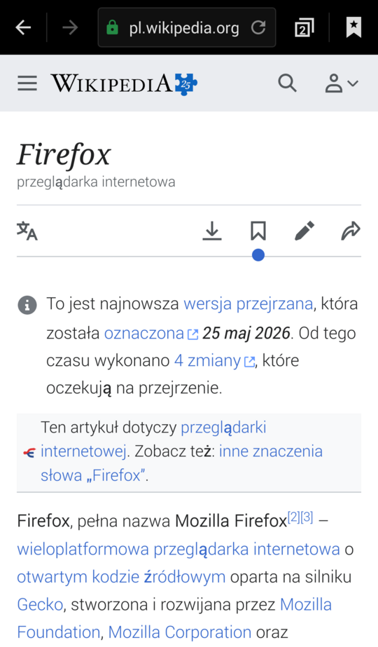
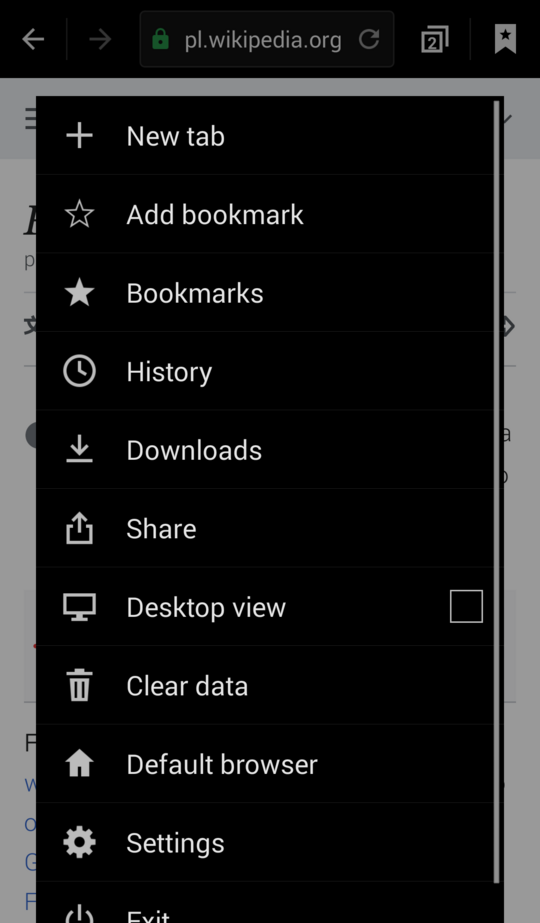

# Gecko-Browser

A lightweight Android web browser built on Mozilla's [GeckoView](https://mozilla.github.io/geckoview/),
made to run well on old phones (Android 4.1+, tested on a Galaxy S4 with Android 4.4) and to stay
usable on newer ones.

Fork of [ethanc8/Gecko-Browser](https://github.com/ethanc8/Gecko-Browser).

<p>
  
  
</p>

## Features

- GeckoView 118 – the last release that still supports Android 4.x
- Tabs: full-screen tab switcher, optional "keep pages loaded in every tab" mode
- Bottom menu on the hardware menu key, history, bookmarks, downloads, share
- Light, dark and OLED (pure black) themes
- Address bar shows the domain; tap to edit the full address, with history and search suggestions
- **Lite mode** for slow devices: no animations, transitions, shadows, filters or transparency,
  no autoplay, lighter video codecs
- Ad and tracker blocking (Gecko's built-in lists)
- Private mode, auto-hiding address bar, long-press menu for links and images

## Download

Get the APK from [Releases](https://github.com/Basket5125/Gecko-Browser/releases):

| APK | For |
|---|---|
| `armeabi-v7a` | most older 32-bit phones (e.g. Galaxy S4) |
| `arm64-v8a` | most phones from 2016 on |
| `x86` / `x86_64` | emulators, x86 tablets |
| `universal` | any device (large) |

## Build

Requirements: JDK 17, Android SDK.

```sh
./gradlew assembleDebug      # app/build/outputs/apk/debug/
./gradlew assembleRelease    # app/build/outputs/apk/release/
```

Release signing reads `keystore.properties` in the project root (git-ignored):

```properties
storeFile=/path/to/release.jks
storePassword=...
keyAlias=...
keyPassword=...
```

Without that file, release APKs are built unsigned.

## Changing the GeckoView version

1. Pick a version from Mozilla's Maven repository:
   <https://maven.mozilla.org/maven2/org/mozilla/geckoview/geckoview/>
   (for Nightly/Beta: `geckoview-nightly/` and `geckoview-beta/` in the same repository).
2. Edit `app/build.gradle`:

   ```groovy
   ext {
       geckoviewChannel = ""   // "-nightly" or "-beta" for those channels
       geckoviewVersion = "118.0.20231009140911"
   }
   ```

3. Update `versionName` to match, then build.

Minimum Android version by GeckoView release:

| GeckoView | Minimum Android | `minSdkVersion` |
|---|---|---|
| up to 118 | 4.1 | 16 |
| 119 – … | 5.0 | 21 |
| current (160+) | 8.0 | 26 |

Raise `minSdkVersion` in `app/build.gradle` when you move past 118. Newer GeckoView versions
may also need a newer `compileSdkVersion` and Android Gradle Plugin.

## License

[GPL-3.0](LICENSE). GeckoView is licensed under the [MPL-2.0](https://www.mozilla.org/MPL/2.0/).
